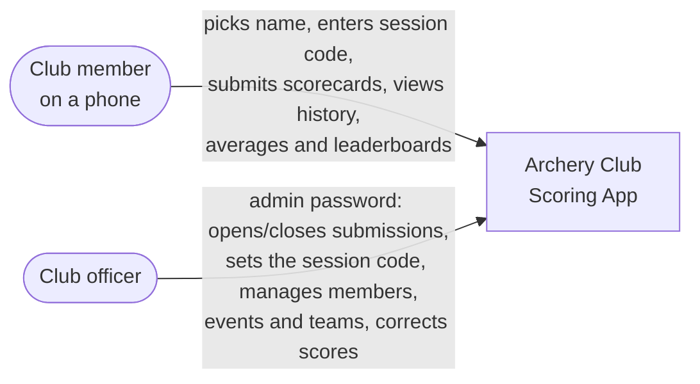
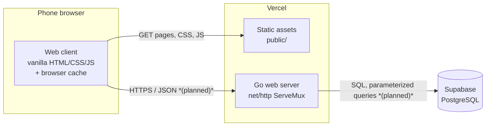
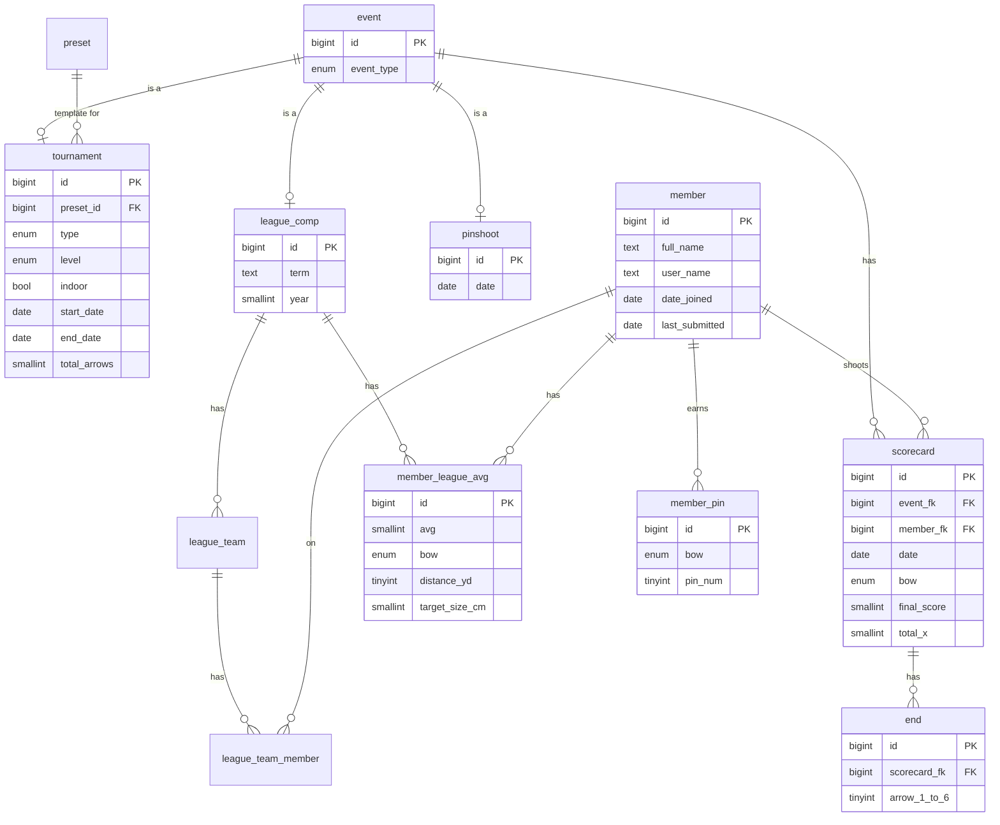

# Design

> **Status at this commit:** walking-skeleton stage. What exists: a Go web
> server (`main.go`) that serves `public/` locally on port 4000, a static
> scorecard page (`public/scorecard.html`, 6 ends × 5 arrows, no script yet),
> and Vercel configuration (`vercel.json`). The database schema is designed
> (below) but not deployed, and no API endpoint exists yet. Sections marked
> *(planned)* describe the agreed target. Update this file in the same PR as
> any change to the architecture, an interface, or the data model.

## Overview

A scoring web app and database for the OSU Archery Club. Members open the site
on their phones at the range, pick their name and the event, enter raw arrow
scores end by end, and submit. They can look back at their scorecards, see
their running averages, and see where they stand on each competition's
leaderboard. Club officers use a separate admin page to manage members, events,
submission windows, and corrections. Everything an officer would reasonably
change is configurable through the UI, because future officers will not touch
the code.

Constraints that shape every decision below (see [docs/requirements.md](./requirements.md)):

- **Phones outdoors on weak signal:** pages stay lightweight, scores are cached
  in the browser, and the client retries generously.
- **No individual accounts:** members choose their name from a list and submit
  with a code the officers give out at practice (see *Access model*).
- **Internal to the club:** pages are not indexed by search engines
  (`X-Robots-Tag: noindex, nofollow` in `vercel.json`); members are told the URL.
- **Handoff:** it must keep running cheaply after our team leaves, under
  accounts the club owns.

## Architecture

### Context (C4 level 1)



No external services beyond hosting. There is no identity provider; access is
controlled by shared codes (below).

### Containers (C4 level 2)



- **Web client** *(exists as a static page)*: score entry, history, averages,
  leaderboards. Vanilla HTML, CSS and JavaScript; the admin page may use a
  framework (ADR to write if it does). Stores unsent scorecards and the
  member's selected name in browser storage so a reload or dropped connection
  loses nothing.
- **Go web server** *(exists, serves files only)*: will own every rule —
  access codes and rate limiting, submission windows, scoring, averages,
  leaderboards, team-making, pin achievements. It is the only component that
  talks to the database; the browser never gets database credentials.
- **Supabase (PostgreSQL)** *(planned)*: used only as a plain Postgres
  database. Decided over Aiven for MySQL, which the hosting RFC
  (`docs/rfcs/rfc-database-hosting.md`) had proposed; ADR-001 `TODO` records
  the decision and why. We do not use Supabase Auth or its auto-generated APIs, so leaving
  Supabase stays a data migration, not a rewrite.

### Access model *(planned)*

Two shared secrets, no accounts. "Session code" is used here to avoid
confusion with archery pins (`member_pin`).

| Secret | Who has it | Unlocks | Protection |
|---|---|---|---|
| Session code | Members, told at practice | Submitting scorecards to an event an officer has opened | Checked server-side, IP rate-limited, accepted only while that event's submission window is open |
| Admin password | Officers only | The admin page and `/api/admin/*` | Checked server-side, IP rate-limited, changeable from the admin page |

Both are stored hashed, never in the repository. Reading history, averages and
leaderboards needs no code.

### Main flow: submitting a scorecard *(planned)*

```mermaid
sequenceDiagram
    participant P as Member's phone
    participant API as Go server
    participant DB as Supabase
    P->>P: enter ends; save scorecard to browser cache
    P->>API: POST /api/scorecards (session code, submission_id, ends)
    API->>API: rate limit, window open?, code valid?, arrows valid?
    API->>DB: insert scorecard + ends in one transaction
    API-->>P: 201 Created
    P->>P: clear that scorecard from the cache
    Note over P,API: On timeout or no signal the scorecard stays cached<br/>and is retried; the same submission_id is never stored twice.
```

## Interfaces *(planned)*

JSON over HTTPS under `/api`. No endpoint exists yet; this table is the
contract until an OpenAPI file replaces it. Changing a row needs agreement from
whoever builds both sides.

| Method & path | Access | Purpose | Notable responses |
|---|---|---|---|
| `GET /api/members` | public | Names for the dropdown (`id`, `full_name`) | — |
| `GET /api/events?open=true` | public | Events currently accepting submissions | — |
| `POST /api/sessions/verify` | public | Check a session code for an event before shooting | `204` ok, `401` wrong code, `403` window closed, `429` rate limited |
| `POST /api/scorecards` | session code | Submit one scorecard with its ends | `201` created, `200` replay of a known `submission_id`, `401`, `403`, `422` invalid scorecard, `429` |
| `GET /api/members/{id}/scorecards` | public | A member's history | `404` |
| `GET /api/members/{id}/averages` | public | Averages per league, bow, distance, target size | `404` |
| `GET /api/events/{id}/leaderboard` | public | Rankings for one event | `404` |
| `/api/admin/*` | admin password | Open/close windows and set the session code, add and bulk-remove members, create events from presets, edit scorecards, make teams | `401`, `429` |

**Scorecard submission body:**

```json
{
  "submission_id": "uuid generated by the client",
  "event_id": 7,
  "member_id": 12,
  "session_code": "4821",
  "bow": "recurve",
  "distance_yd": 20,
  "target_size_cm": 40,
  "ends": [[10, 9, 9], [10, 10, 8]]
}
```

- `submission_id` makes retries safe: the server treats a repeated id as the
  same scorecard, never a second one. Needs a unique column on `scorecard`
  (not yet in the schema).
- The server computes `final_score` and `total_x` from `ends`; the client's
  totals are display-only.
- Each end has 3 to 6 arrows, matching `end.arrow_1`…`arrow_6`.

## Data

Schema designed in drawSQL (export: `TODO path in repo`); not yet deployed.
The export is MySQL syntax; the first migration ports it to PostgreSQL
(each `ENUM` becomes a Postgres enum type or a `CHECK` constraint, and
`BIGINT UNSIGNED AUTO_INCREMENT` becomes `BIGINT GENERATED ALWAYS AS IDENTITY`).



- **Events:** `event` is the parent of three kinds — `tournament`,
  `league_comp` (long-term, cumulative), and `pinshoot` — each sharing the
  parent's `id`. A `preset` stores the settings of a recurring tournament so
  officers don't re-enter them.
- **Scores:** one `scorecard` per member per event submission, with its ends.
  Distance, target size and bow live on the scorecard because they vary by bow
  even within one event.
- **Stored vs derived:** `final_score`, `total_x` and `member_league_avg` are
  stored, computed by the server when a scorecard is saved or edited, so
  leaderboards stay fast on weak connections. The ends are the source of truth;
  an admin edit recomputes the stored values.
- **Privacy:** member names, scores and averages are club members' personal
  data. Seed data uses invented members only; credentials live in environment
  variables, never in the repository.

## Deployment

**Production target (walking skeleton, fall week 10):** the Go server and
static pages on **Vercel**, the database on **Supabase**, both under accounts
owned by the **OSU Archery Club**, not a student. Our project partner agreed to
this on Tuesday, October 27, 2026. The walking skeleton is: a member opens the production URL
on a phone, fills in the scorecard page, and the scorecard lands in the
production database.

- **Environments:** local (`go run .` serves `public/` at
  `http://localhost:4000`) and production. Vercel's GitHub integration is not
  on yet, so there are no preview deploys; until it is, changes are exercised
  locally before they merge. Turning it on gives every pull request a preview
  deploy, which becomes our staging environment. `TODO: owner and date`
- **Secrets:** database connection string and code hashes in Vercel environment
  variables; `.env.example` lists the names.
- **Rollback:** promote the previous Vercel deployment. Schema migrations need
  a tested down step before they merge, because a deploy rollback does not undo
  a migration.
- **Known hosting risks** (tracked in [docs/risks.md](./risks.md)): Supabase's
  free tier pauses after a week of inactivity and has no automatic backups, and
  the club may go weeks between seasons without using the app.

## Deferred decisions

Left open on purpose; each gets an ADR when decided.

- **Double-scoring:** optional second and third scorecards for the same archer
  from other archers. Needs a way to record who scored a card and how
  mismatches are resolved; the schema does not model it yet.
- **Admin page framework:** vanilla JS unless the admin page outgrows it.
- **Team-making algorithm** for `league_team`: manual first, balanced by
  `member_league_avg` later.
- **Supabase plan:** Free during development; Pro (no pausing, daily backups)
  or a keep-alive before the club enters real data.
- **Live leaderboard updates:** page refresh for now.

## Open technical questions

- **Schema fixes in the Postgres port** (George Leyva, Emily McPherson):
  - The `preset` foreign key points the wrong way: `tournament.preset_id`
    should reference `preset.id`, not the reverse.
  - Foreign-key columns and ids must share one type; Postgres has no
    unsigned integers, so both become `BIGINT`.
  - `event.event_type` is an empty enum; it should list `tournament`,
    `league_comp`, `pinshoot`.
  - Arrows are `TINYINT`, so an X and a 10 look the same per arrow and a miss
    must be `0`; decide whether X is stored per arrow or only in `total_x`.
  - `end` has no end number; decide whether insert order is enough.
  - `scorecard` needs a unique `submission_id`, and probably a status for
    double-scoring.
  - `member` has no active/approved flag for the admin's bulk removal, and
    `last_submitted` is `NOT NULL` for a member who has never submitted.
  - Settings (code hashes, submission windows per event) need a home.
- **Arrows per end:** the page shows 5 arrow columns; the schema allows 3 to 6.
  Which rounds use which?
- **Browser cache on phones:** does stored data survive iOS/Android browsers
  clearing storage? Spike on real phones at the range. `TODO owner`
- **Go on Vercel:** confirm the server in `main.go` runs on Vercel as
  configured, since locally it only serves files when `PORT` is unset.
  (David Hausman)
